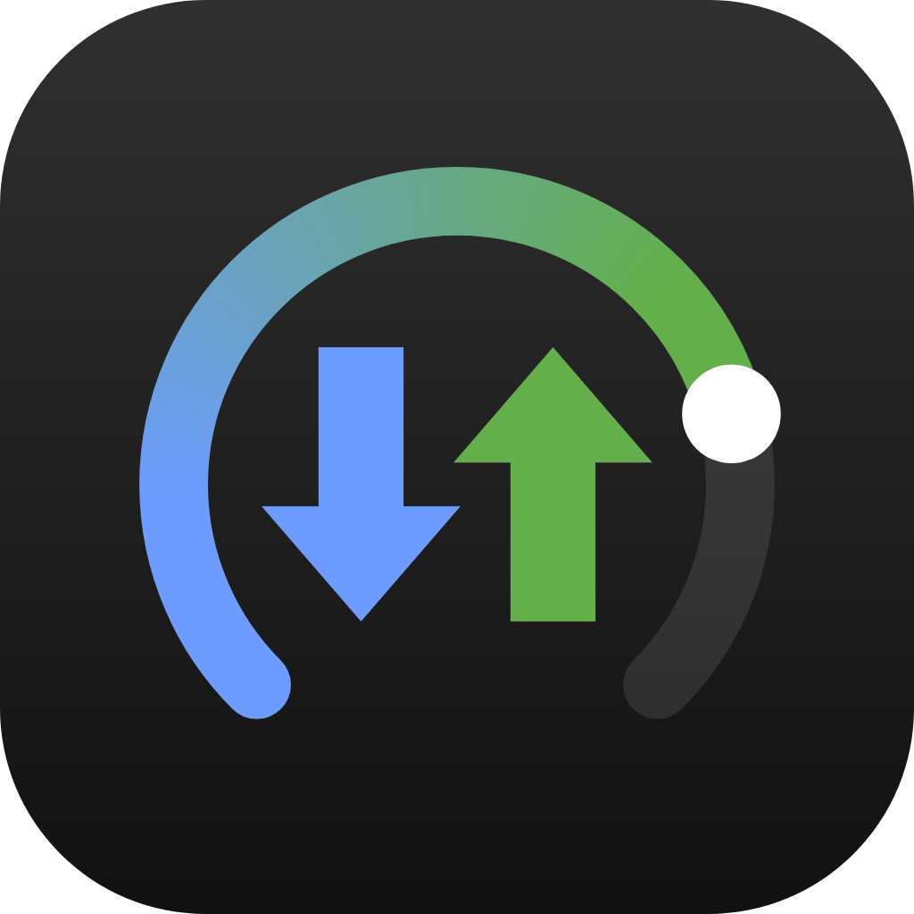
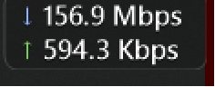
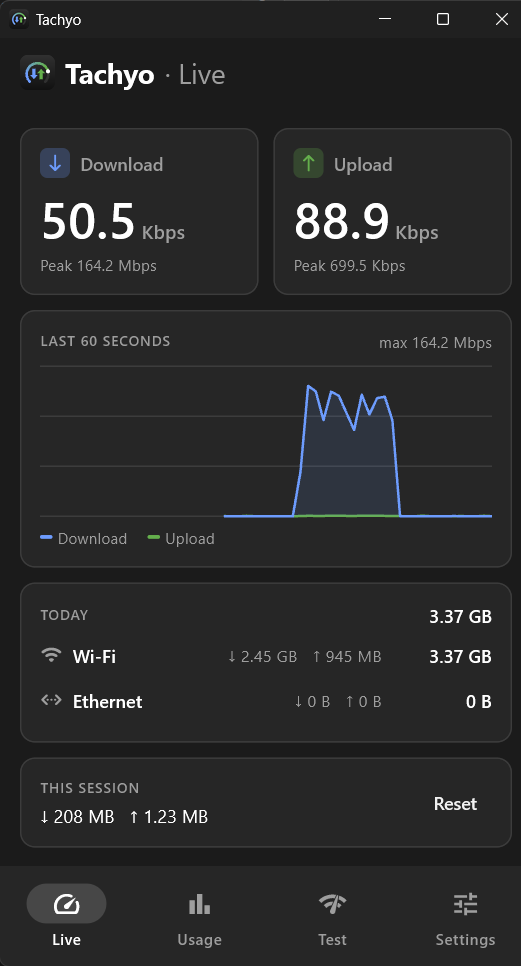
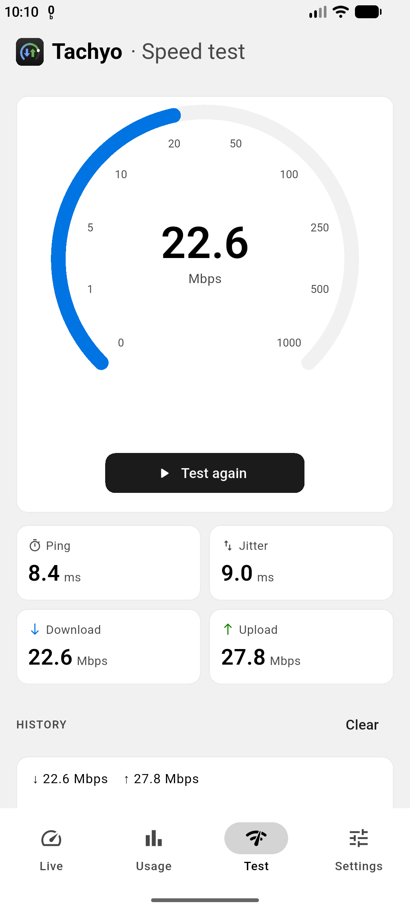

# Tachyo – Net Speed Meter

**See how fast your internet is moving, right now and all day.**

Tachyo is a free, open-source net speed meter for **Windows** and **Android**, built with Flutter. It shows your live download and upload speed in a small always-on meter, counts how much data you use each day, and tests your internet speed.

No ads. No account. No telemetry. No location permission.

| Windows floating meter | Windows app | Android speed test |
| --- | --- | --- |
|  |  |  |

## Why use it?

- **Know what your connection is doing.** A download crawling? A video stuttering? One glance at the meter shows whether data is moving.
- **Check the speed you pay for.** The built-in speed test measures ping, jitter, download and upload in Mbps, the way ISP plans are sold.
- **Keep an eye on data use.** Daily totals for Wi-Fi, Ethernet and mobile data, with a 30-day history.

## Features

| | Windows | Android |
| --- | --- | --- |
| Live speed (↓/↑, peaks, 60-second chart) | ✓ | ✓ |
| Always-visible meter | Glass floating meter + tray icon | Status-bar icon + notification |
| Floating meter | Small see-through strip; text turns light or dark to match what is behind it; stays in front of other apps and hides during full-screen apps; drag to move | – |
| Runs in the background | Closing the window keeps Tachyo in the tray; only tray **Exit** quits | Foreground service |
| Starts automatically | Start with Windows (tray + floating meter, no window) | Meter restarts after reboot |
| Daily usage | Wi-Fi / Ethernet, 30 days | Wi-Fi / Mobile, 30 days |
| Speed test | Ping, jitter, download, upload, history, provider name | same |
| Units | Kbps/Mbps (default) or KB/s/MB/s; Auto or one fixed unit | same |

## Download and run

Ready-made builds are not published yet; build from source as shown below.

- **Windows:** run `build\windows\x64\runner\Release\tachyo.exe`. Tachyo opens its window and shows the floating meter; closing the window keeps it in the tray (hidden icons). Use **Exit** in the tray menu to quit.
- **Android:** install `build\app\outputs\flutter-apk\app-release.apk`, open Tachyo and switch on **Status bar meter**. The current APK is debug-signed.

## Privacy and your data

Tachyo reads only the byte counters your operating system already keeps (Android `TrafficStats`, Windows `GetIfTable2`). It does not look at what you browse, which apps you use, or where you are.

- **No location permission.** Android permissions: internet (speed test only), notifications, foreground service and start at boot.
- **The speed test is the only network traffic.** It uses Cloudflare's public test servers (`speed.cloudflare.com`), which see your IP address like any website. Your provider name and the test server's city come from that IP address, not from GPS.
- **A test uses data:** roughly 50–500 MB depending on your speed. On mobile data it counts toward your plan.
- **Local files only:** Windows keeps usage, settings and test history in `%APPDATA%\Tachyo`; Android keeps them in the app's private storage.

## How speeds are measured

- **Live meter:** once per second Tachyo reads the total bytes sent and received by your network adapters and divides the change by the elapsed time. On Windows only physical adapters count, so VPN and virtual adapters are not counted twice.
- **Speed test:** 20 tiny requests measure ping (the fastest round trip, minus the server's own processing time) and jitter. Then 6 parallel downloads run for 10 seconds and 4 parallel uploads for 8 seconds; the first 1.5 seconds are skipped while connections speed up.
- Two meters or two speed tests rarely show identical numbers: they read at different moments and use different servers.

## Build from source

### Prerequisites

- Windows 10/11 x64 and Git.
- Flutter on PATH with Dart **3.13.5 or newer** (built with **Flutter 3.47.7**).
- **Visual Studio** with **Desktop development with C++** for the Windows app.
- **Android SDK** (Android Studio) for the APK; an emulator or phone for testing.

~~~powershell
flutter doctor -v
~~~

### Clone, test and build

~~~powershell
git clone https://github.com/Anantha-Gokula-Raman-J/Tachyo.git
cd Tachyo
flutter pub get
flutter analyze
flutter test
flutter build windows --release
flutter build apk --release
~~~

## Development checks

Before changing code, read [AGENTS.md](AGENTS.md), [ARCHITECTURE.md](ARCHITECTURE.md) and the [spec index](specs/INDEX.md). Specs describe intended behavior and are updated in the same change as the code.

~~~powershell
.\harness\context.ps1 -Feature <ID>      # specs and source for one feature
.\harness\verify.ps1 -Build              # analyze, tests, Windows + Android builds
.\harness\android_test.ps1               # install and smoke-test on the emulator
~~~

## Project structure

~~~text
lib/
  main.dart        Entry point
  src/core/        Sampling, formatting, dates
  src/data/        Settings, usage and history storage
  src/platform/    Method channel and Windows/Android adapters
  src/speedtest/   Speed test engine, transport, history
  src/state/       Meter controller
  src/ui/          Pages, widgets, Astryx-based theme
android/           Foreground service, status-bar icon, boot receiver (Kotlin)
windows/runner/    Tray, floating meter, startup, single instance (C++)
test/              Unit and widget tests
specs/             Module specs (overview, APIs, data flows, edge cases)
harness/           Verify, context and device-test scripts
tool/              Manual checks and screenshot helpers
~~~

## Contributing

Bug reports, documentation fixes and focused pull requests are welcome. See [CONTRIBUTING.md](CONTRIBUTING.md). Remove personal details (IP address, provider, location) from screenshots and logs.

## Current scope and limitations

- Windows x64 and Android only.
- Release signing (Android keystore, Windows code signing) is not set up yet.
- English only.
- The Android emulator's virtual network limits speed test results; test on a real phone.
- Closing the Windows window does not quit Tachyo; this is intentional.

## License

Tachyo is available under the [MIT License](LICENSE). It is a standalone project, not affiliated with any company or other net speed meter app. Third-party code is limited to MIT or Apache-2.0; Tachyo adds no third-party packages. See [THIRD_PARTY_LICENSES.md](THIRD_PARTY_LICENSES.md).

UI tokens are ported from the [Astryx](https://github.com/meta/astryx) Neutral theme (MIT). Feature research used [Craft Anything](https://github.com/storytold/craft-anything) (MIT/Apache-2.0) in clean-room mode; no code, text or assets come from other apps.
